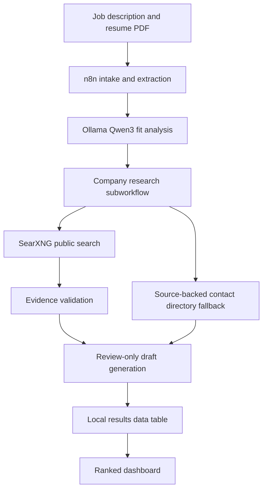

# Local AI Job Search Agent

A self-hosted n8n project that helps candidates assess job fit, research relevant professional contacts, and prepare outreach for human review.

## Why I built it

Job hunting involves repetitive research: compare a posting with a résumé, learn about the company, identify relevant hiring stakeholders, and prepare a thoughtful follow-up. I built this as a personal Solutions Engineering project to explore how local AI, APIs, and workflow automation can reduce that repetition without taking away human judgment.

## Architecture

| Component | Responsibility |
| --- | --- |
| Docker | Host local services |
| n8n | Form intake, orchestration, branching, data persistence |
| Ollama / Qwen3 4B | Fit assessment and text generation |
| SearXNG | Public web research |
| JavaScript | Evidence checks, score calculation, deduplication, dashboard rendering |
| Codex | Assisted with inspecting executions, diagnosing failures, and implementing fixes |

## What the prototype does

- Accepts a job description and PDF résumé; extracts candidate facts locally.
- Uses a weighted fit rubric: mandatory requirements (70), core responsibilities (20), preferred qualifications (10). JavaScript checks and sums the category scores; users can override the displayed priority.
- Searches for public, role-relevant professional evidence. An unavailable search provider produces an explicit failure rather than invented people.
- Looks up independently sourced contacts in a local directory when web search is unavailable. The directory requires human-maintained evidence and is not a guarantee that a title is current.
- Creates drafts for review only; it does not send messages, submit applications, or infer application status.
- Displays ranked, color-coded job results, source links and copyable drafts.

## Local setup

1. Run n8n and SearXNG locally (for example, using Docker). Run Ollama on the host and download `qwen3:4b` using `ollama pull qwen3:4b`.
2. Make the services reachable from n8n. In Docker Desktop on macOS, an example host alias is `host.docker.internal`. Configure the Ollama credential locally and ensure SearXNG supports JSON search output.
3. Create the result and contact-directory tables described in [the integration notes](docs/setup.md). Keep them private. Import the sanitized workflows in the order below and reselect locally created credentials, data tables and the research subworkflow in n8n.
4. Execute the form trigger, enter an example role, upload a sanitized résumé, and review the execution and dashboard. Never expose a résumé upload form or local dashboard publicly unless access is secured.

## Workflow exports

The following three sanitized n8n exports are included:

1. [Company research](workflows/company-research.json) — import first; configure the local search endpoint.
2. [Main job search](workflows/main-job-search.json) — import second; reselect the Ollama credentials, imported research workflow, and private data tables.
3. [Synthetic QA batch](workflows/qa-synthetic-tests.json) — import last; link it to the imported main workflow. The four examples are fictional, with an invented candidate profile.

These exports are intentionally inactive, contain no pinned execution data, and require local configuration before execution. The dashboard renderer is documented in [the integration notes](docs/setup.md); a standalone synthetic [dashboard example](examples/dashboard.html) is included. The original personalized score settings are not distributed.

## What failed and what I learned

The initial research chain returned empty contact results. Execution inspection showed an upstream search-provider outage, rather than proof that relevant contacts did not exist. I separated deterministic validation from model-generated text and introduced a source-backed directory fallback.

I also observed incorrect model arithmetic and inconsistent interpretations of mandatory versus optional requirements. The workflow now sums category scores in code; calibration is still an ongoing task. A score is a prioritization aid, not a hiring decision.

During a four-job test, all four roles produced fit assessments. Live contact discovery failed during the provider outage. Independently sourced directory entries were then used to verify that the fallback generated contact rows, evidence links and drafts. This establishes fallback behavior, not universal autonomous discovery accuracy.

## Roadmap

- Improve search resilience using permitted, reliable sources and graceful rate-limit handling.
- Calibrate the rubric against a diverse benchmark of roles and verify scoring consistency.
- Improve fallback drafts with role-specific, supported candidate evidence.
- Add repeatable fixtures, explicit confidence and source freshness indicators, and latency measurements.

## Privacy

The public portfolio intentionally excludes personal résumés, private contact records, actual job-search results, account credentials, instance-specific IDs and cached execution data. Examples should be synthetic. The separate MCP prototype is not a dependency of this workflow.
